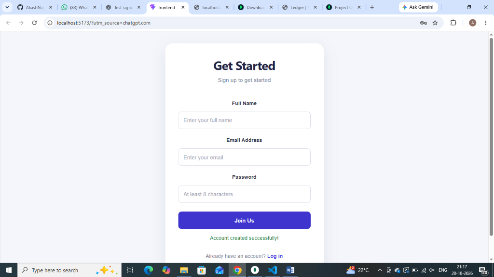
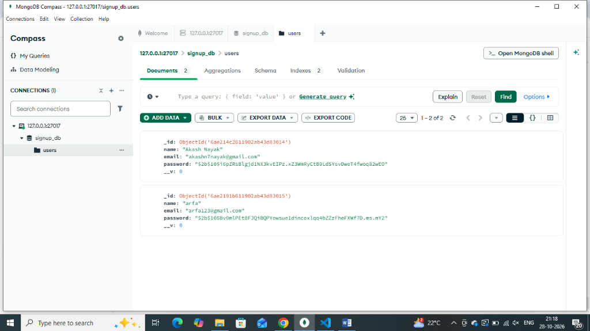

# Full-Stack Authentication System

A full-stack web application that allows users to create an account through a simple and user-friendly signup form. The application uses **React** for the frontend, **Node.js** and **Express** for the backend, and **MongoDB** to store user information securely.

---

## 📸 Screenshots

### 1. Signup Page


> **Description:** The user registration page featuring a clean and intuitive form with inputs for Full Name, Email Address, and Password, along with a "Join Us" submission button and link to log in.

---

### 2. Successful Registration


> **Description:** Confirmation message (`"Account created successfully!"`) displayed directly below the submit button upon submitting valid and verified registration details.

---

### 3. MongoDB Database


> **Description:** View from MongoDB Compass showing the stored user documents in the `signup_db.users` collection. User passwords are automatically salted and hashed using `bcrypt` before being saved to the database.

---

## ✨ Features

- **User Registration:** Simple, clean signup form built with React.
- **Form Validation:** Input validation for full name, email format, and password length (minimum 8 characters).
- **API Integration:** Seamless client-to-server HTTP POST communication with Express.
- **Duplicate Prevention:** Automatic verification to prevent duplicate email registrations.
- **Password Security:** Safe password hashing using `bcryptjs` with 10 salt rounds.
- **Database Storage:** Persistent data storage using MongoDB and Mongoose schemas.
- **Dynamic Feedback:** Instant real-time success and error messages for user feedback.
- **Responsive Design:** Clean, centered card layout optimized across screen sizes.

---

## 🛠️ Technologies Used

| Technology | Purpose |
| :--- | :--- |
| **React** | Frontend user interface |
| **Vite** | Frontend build tool and development server |
| **CSS3** | Responsive UI styling and layout |
| **Node.js** | Backend JavaScript runtime environment |
| **Express.js** | Backend REST API framework |
| **MongoDB** | NoSQL document database |
| **Mongoose** | MongoDB object data modeling (ODM) |
| **bcryptjs** | Password encryption and hashing |
| **Git & GitHub** | Version control and code repository |

---

## 📂 Project Structure

```text
signup-project/
├── backend/
│   ├── server.js
│   ├── package.json
│   └── package-lock.json
├── frontend/
│   ├── src/
│   │   ├── App.jsx
│   │   ├── App.css
│   │   ├── index.css
│   │   └── main.jsx
│   ├── index.html
│   ├── package.json
│   └── package-lock.json
├── screenshots/
│   ├── signup.png
│   ├── registration-success.png
│   └── mongodb-compass.png
├── .gitignore
└── README.md
```

---

## ⚙️ Getting Started

### Prerequisites

Install the following before running the project:
- [Node.js](https://nodejs.org/) (v16 or higher) and npm
- [MongoDB](https://www.mongodb.com/try/download/community) running locally (port 27017) or a MongoDB Atlas connection string
- [Git](https://git-scm.com/)

---

### 1. Clone the repository

```bash
git clone https://github.com/AkashNayak1223/full-stack-authentication-system.git
cd full-stack-authentication-system
```

---

### 2. Configure and run the Backend

Open a terminal and navigate to the `backend` directory:

```bash
cd backend
npm install
```

Create a `.env` file inside the `backend` folder:

```env
PORT=5000
MONGO_URI=mongodb://127.0.0.1:27017/signup_db
```

> **Note:** Ensure your MongoDB service is running locally on your computer.

Start the backend server:

```bash
node server.js
```

The backend server runs at:
```
http://localhost:5000
```

---

### 3. Configure and run the Frontend

Open a second terminal window from the project root and navigate to `frontend`:

```bash
cd frontend
npm install
npm run dev
```

Open the local development URL displayed by Vite (usually):
```
http://localhost:5173
```

---

## 🔐 Security Notes

- **Password Hashing:** Passwords are never stored in plain text. They are hashed using `bcryptjs` before being saved to MongoDB.
- **Backend Validation:** The backend validates all signup requests to ensure data integrity.
- **Duplicate Prevention:** Duplicate email registrations are rejected with a `409 Conflict` status.
- **Environment Isolation:** Sensitive database URIs and port numbers are managed through `.env` files and excluded from version control via `.gitignore`.

> **Note:** This project currently implements signup functionality. A full authentication system should additionally include a login flow, session/token handling (e.g., JWT), and protected route authorization.

---

## 👨‍💻 Author

**Akash Nayak**  
GitHub: [@AkashNayak1223](https://github.com/AkashNayak1223)

---

⭐ If you found this project useful, feel free to give it a star!
